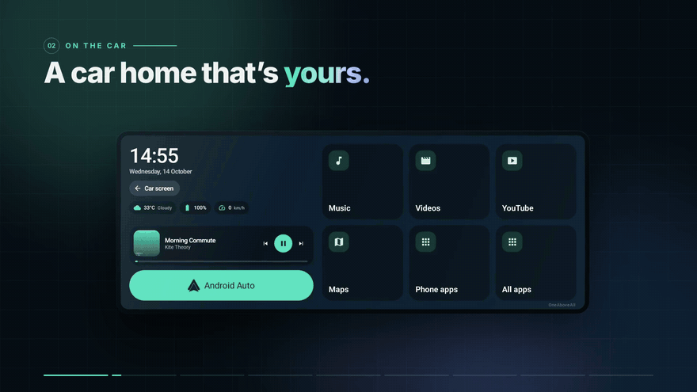

# FT

<a href="docs/ft-tour.mp4"><b>Watch the full tour</b></a> (2½ minutes, with sound)

FT turns an Android phone into the phone side of Baidu CarLife, so a Chinese-market head unit shows FT's own launcher on the car display. From there the car can show the phone's real Android Auto with one button, mirror any phone app with the car's touchscreen driving it, or run real phone apps side by side on the car while the phone screen stays dark.

FT speaks CarLife the way the official Baidu CarLife app does: the same handshake order, the same way of starting, pausing and resuming the picture, and the same media and navigation messages around sound. Where Baidu's choices can be changed, the settings can change them.

FT runs in English, Arabic, Kurdish Sorani and Kurdish Badini, on the phone and on the car screen, in a light, dark or automatic look.

## How it connects

Three ways, picked on Home:

- **Hotspot** (default). The car joins the phone's hotspot. FT listens on the CarLife ports and sends a discovery beacon on UDP 7999 until the car connects.
- **WiFi + BL**. Bluetooth wakes the car, the car raises its WiFi Direct group, FT joins it and the car connects over WiFi Direct. FT starts a join only when none is already running, so the car's repeated "ready" message never cancels a join in progress.
- **USB**. Baidu's accessory mode over the cable, with all six channels in one pipe. A cable always wins over WiFi, and unplugging goes back to the chosen way.

FT starts by itself when the car's Bluetooth connects, and a Quick Settings button switches it on or off without opening the app. If Android stops FT mid-drive, FT listens for the car again as soon as Android restarts it.

Then the CarLife handshake, as Baidu does it:

1. FT answers the protocol version, tells the car it is in front and whether the phone screen is on, sends its device info and, half a second later, the module list.
2. The car's statistics are answered with the authentication result and a request for its feature list. If the car wants content encryption, its RSA key wraps a fresh AES session key and everything after that is encrypted.
3. The car's data subscription is answered: FT offers song info.
4. On `VIDEO_ENCODER_INIT` FT replies with the picture size it really sends, so touches land where they should.

## Picture

- By default FT sends the car its own screen size (1920×720 on a Corolla) at 3 Mbps. **Like Baidu** sends Baidu's smaller size from its table (1280×720 for the Corolla), and **Custom** takes any size. FT draws at the car's full size, so nothing is stretched.
- When the car asks for no frame rate, FT starts at 30 frames a second on Hotspot, and at 20 on WiFi Direct before moving to 30. It then follows what the car asks for between 15 and 30; like Baidu, it never paces below 15. A hot phone drops to 24 or 20 to cool down.
- H.264 Baseline, a full picture every second, and a quality floor that keeps full pictures small enough for the car to take.
- The codec header goes out once, with the first full picture. If the car asks for a reset, FT sends the header again with a fresh full picture.
- While the car shows its own screens (the reverse camera, for example), only heartbeats go out. When it comes back, FT keeps drawing for a moment so the encoder makes its next regular full picture within about a second, even if nothing on FT's screen is moving. FT forces a full picture only if none has come after 2.5 seconds; on the Corolla, forced full pictures on resume left the screen black.
- A heartbeat goes out at least every 0.9 seconds at any frame rate, so the car's video watchdog never drops the connection.

## Sound

- Car sound goes out as 48 kHz stereo on the media channel: FT's own player, Android Auto's media and other apps' sound. The phone speaker is silenced while FT streams, and **Use the car's bluetooth for sound** plays it over Bluetooth instead.
- When sound starts FT tells the car the way Baidu does: `MEDIA_INIT`, `MEDIA_STOP`, `MEDIA_INIT` and the music module switched on. After 750 ms of quiet it sends `MEDIA_PAUSE` and switches the music module off.
- Spoken directions go to the car's own voice channel and the navigation module is raised around them, so the car decides how the music sits underneath (Baidu's way). **In step** and **On time** in Settings make FT mix or dip the music itself instead.
- Sound sockets are marked for the WiFi voice queue and the picture for the video queue, so sound goes first.
- Starting the sound, screen sharing and opening apps run off the thread that draws the car screen, so the car picture never freezes while they start.

## Touch

Every CarLife touch message is understood: touch actions, down, up and move, single and double clicks, long presses and two-finger gestures. Moves are merged so the car screen never falls behind a finger, and the place where the finger lifts always counts as the last move, so drags and scrolls end where the finger did. Touches are mapped from the stream to FT's full-size screen. On a mirrored phone, a touch on the black bars beside the picture is ignored instead of pressing the phone's edge.

## On the car screen

- Tiles for Music, Videos, YouTube, Maps, the browser, all apps, the phone screen, phone apps and Android Auto, in the order and number of columns you choose.
- A clock and widgets for weather, phone battery, speed and your next calendar event, a now-playing card and a button for the car's own screen.
- Background colours or your own photo, an accent colour, and a separate night look that switches at sunset and sunrise where you are.
- The FT button sits in the corner you choose and always returns to FT's car home.
- Phone apps mirrored to the car get phone keys on the car (back, home, recents, rotate and notifications). The browser keeps its page, history and full-screen video for the whole drive, and the steering wheel's back key walks back through it.

## Phone apps on the car

With root, or once from a computer with one adb line, FT starts a small helper from its own APK that runs real phone apps on hidden screens and shows them on the car:

- One app or two side by side, picked from a dock that lists only the apps you choose. **Swap** puts the two apps in each other's places, each keeping its width.
- Drag the handle between two apps to give one more room, anywhere from a quarter to three quarters of the width; it settles in the middle when let go near it, and a double tap puts it back in the middle. While it moves, each app shows its name, and its hidden screen takes the new size once the finger lifts. FT remembers the split.
- **Full screen** shows the apps edge to edge with nothing around them except an exit button in the FT button's corner; the car's back key also leaves full screen. **Hide apps** tucks the dock away behind a small handle.
- The hidden screens never turn. An app that asks for portrait, like YouTube leaving full screen, stays upright in a 4:3 box in the landscape picture. Each app on the car measures its own window rather than the whole hidden screen, so YouTube's exit-full-screen button works and the app stays out of full screen until asked again. Both settings are undone when apps on the car are switched off.
- The phone screen goes dark while apps run on the car. The power button lights it to use the phone and darkens it again, and it goes dark by itself after the phone's screen timeout once nobody is touching it. Closing a cover or folding the phone never lights it.

## Android Auto

The head unit speaks CarLife, not Android Auto, so FT shows **your own phone's** Android Auto on the car: it runs an Android Auto head unit inside FT, asks Android Auto to project into it, and draws that picture on the car screen with the car's touchscreen driving it. Home starts it, and it can start by itself after the car connects. With root, FT switches on Android Auto's head unit server itself.

When the assistant listens, FT asks the car to record from its own microphone and passes that sound to Android Auto. When the assistant stops, FT ends the recording and turns the car's microphone light off.

## Steering wheel and gears

- The steering wheel's next, previous, play, pause and voice keys reach FT's player, the app playing on the phone or Android Auto. Next and previous can be swapped.
- Next and previous can each do something else when pressed twice quickly: open Android Auto, the car's own screen, Maps or the phone screen, play or pause, or start the voice assistant. A button with a second action waits 300 ms to see if a second press follows.
- **Gear actions** do something when the car shifts into reverse or park:
  - the screen: show the car's own screen (the default in reverse, for the camera), FT home, Maps or Android Auto;
  - the sound: pause it, or turn it down to a level you pick.

  Shifting out brings back only what the gear changed: music plays again only if the gear paused it, and the sound comes back up only if the gear turned it down.

## Settings

Language and look, car screen, picture, sound, car and connection, apps on the car, Android Auto, backup and advanced (the CarLife ports). **Picture** can send the car's own size, Baidu's size or a custom size, fix the frame rate, set the data rate and the quality floor, and put everything back to the defaults. **Backup** saves and loads every setting and can share the car look as a code.

## Diagnostics

Every protocol message is logged with its bytes on the Log tab, so a head unit's behaviour is visible on the first connection. The report button saves a zip to Downloads with the log, the phone's details, the system log and any crashes, ready to share.

## Test harness

`tools/sim/` has a CarLife head-unit simulator and an Android Auto phone simulator that speak the real wire protocols. The CarLife simulator checks Baidu's handshake order, the stream size in `INIT_DONE`, the codec header, pause and resume (including a quick trip to the car's own screen while nothing on FT's screen moves), gear changes, picture resets, the media and navigation modules, and it can demand content encryption. It dials again while FT is still starting, the way a car does, and its touch script can tap, drag and double tap.

`tools/sim/e2e.sh [apk] [outdir]` installs FT on a connected emulator and runs plain, encrypted and Corolla-shaped head units, a USB test cable and the Android Auto phone through touches, music, video, directions, screen sharing, phone apps on hidden screens and the Quick Settings button, then prints PASS or FAIL for each check. Each session waits until FT is listening before the car dials. Run the emulator on the host GPU (`emulator -avd <name> -gpu host`): with software rendering the emulator's video encoder falls seconds behind and the picture-timing checks fail.

## Tour video

`tools/video/` makes the tour above. Real car and phone screenshots from the emulator sit on one timed HTML page, headless Chrome draws it frame by frame, and ffmpeg encodes the frames. The story pauses wherever there is something to read, while the background keeps moving. After `npm install`, `./music.sh` mixes the soundtrack from Apple Loops on the Mac, `node render.mjs --fps=60 --audio=out/bed.wav --out=<file>` renders the whole video, `--stills=14,38.5` saves single frames to check a moment, and `--holds=0.4` shortens the pauses, as the moving preview does.

## Building

Gradle wrapper, AGP 8.13, Kotlin 2.3, Compose Material 3 Expressive, Android 10 and newer. `./gradlew assembleRelease` builds `app/build/outputs/apk/release/app-release.apk`, signed with the keystore named in `keystore.properties`. The phone-apps helper lives in `server/` and is packed into the same APK.

## Credit and license

FT is made by [OneAboveAll1964](https://github.com/OneAboveAll1964).

It is released under the [Apache License, Version 2.0](LICENSE). You may use, change and share it, including in your own apps, as long as you keep the [NOTICE](NOTICE) file and credit OneAboveAll1964 with a link to https://github.com/OneAboveAll1964 in any fork, copy or app built from it, and say what you changed.
