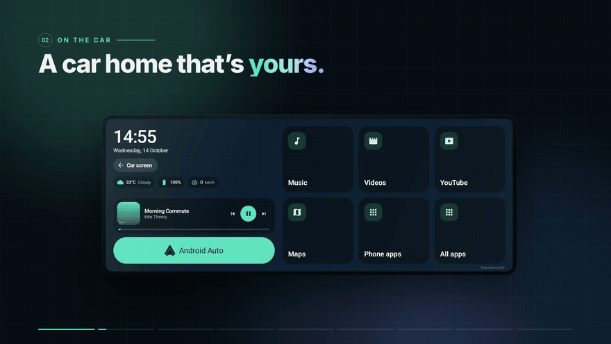

# FT

<a href="docs/ft-tour.mp4"><b>Watch the full tour</b></a> (2½ minutes, with sound)

FT turns an Android phone into the phone side of Baidu CarLife (or, experimentally, ICCOA Carlink), so a Chinese-market head unit shows FT's own launcher on the car screen. From there the car can show your phone's real Android Auto, mirror any phone app, or run real phone apps side by side while the phone screen stays dark.

FT runs in English, Arabic, Kurdish Sorani, Kurdish Badini and Russian, in a light, dark or automatic look.

## Connecting

Pick one on Home:

- **Hotspot** (default): the car joins the phone's hotspot.
- **WiFi + BL**: Bluetooth wakes the car and FT joins its WiFi Direct.
- **USB**: over the cable. A cable always wins over WiFi.

FT starts by itself when the car's Bluetooth connects, and a Quick Settings button switches it on or off. **My cars** keeps separate settings for each car. More detail: [wireless connection](docs/wireless-connection.md).

## ICCOA (experimental)

Some cars, such as the Toyota XA60, use ICCOA Carlink instead of CarLife. Pick it per car in **My cars → Protocol**; CarLife stays the default.

- FT finds the car over Bluetooth, joins its WiFi and pairs with the six-digit code on the car screen.
- Android Auto, mirrored apps, sound, the microphone, touch and the car's GPS work over ICCOA, with a touch calibration for cars whose touches land off target.
- Only the car's own WiFi (access point) mode is supported so far.

See the [tester notes (Russian)](docs/ICCOA-TESTER-RU.md) and [development notes](docs/ICCOA-DEVELOPMENT.md).

## Features

- **Android Auto** from your phone, drawn full screen on the car with its touchscreen, the car's microphone and song info on the car's display. Without root, enable the **FT — Android Auto server** accessibility helper ([details](docs/AA-STARTER-2026-11-04.md)).
- **Phone apps on the car**: one or two real apps side by side with the phone screen off. Set up with root, the phone's own debug bridge, or one adb line from a computer (**Settings → Apps on the car**).
- **Car screen**: app tiles, clock, weather, battery, speed and calendar widgets, a music card, your own background and a night look.
- **Steering wheel and gears**: media keys with double-press actions, and actions on reverse or park (camera, pause or lower the sound).
- **Directions** from Android Auto on the instrument cluster or HUD, on cars that support it.
- **Backup** of every setting, and a shareable car look code.
- **And many more**

## Troubleshooting

## Troubleshooting

- Wireless connection drops when the phone unlocks? Set **Developer options → Default USB configuration** to **No data transfer**.
- The Log tab shows every message and has **Android Auto disconnects? What to check**. The share button saves a report zip.

## Building

There are two flavors. `./gradlew assembleGithubRelease` builds the GitHub APK (`app.ft`) at `app/build/outputs/apk/github/release/`, signed with the keystore in `keystore.properties`. `./gradlew bundlePlaystoreRelease` builds the Google Play bundle (`com.shkomaghdid.ft`) at `app/build/outputs/bundle/playstoreRelease/`, signed with the upload key in `keystore-play.properties`; Google Play signs what users install. The Play build never uses root and explains each permission and accessibility service before asking; see [PRIVACY.md](PRIVACY.md). Both keystore files stay on your machine and are ignored by git. Android 10 and newer. Simulators for testing are in `tools/sim/`.

## Credit and license

FT is made by [OneAboveAll1964](https://github.com/OneAboveAll1964). Development assistance — [@mykolaq](https://github.com/mykolaq).

It is released under the [Apache License, Version 2.0](LICENSE). You may use, change and share it, including in your own apps, as long as you keep the [NOTICE](NOTICE) file and credit OneAboveAll1964 with a link to https://github.com/OneAboveAll1964 in any fork, copy or app built from it, and say what you changed.
