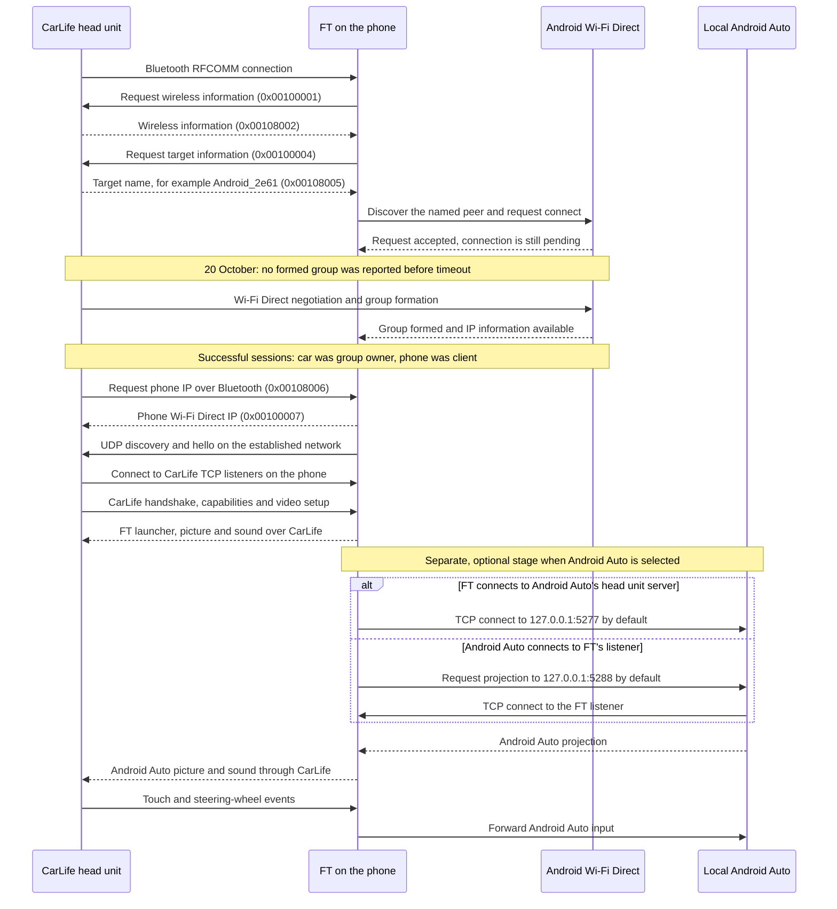
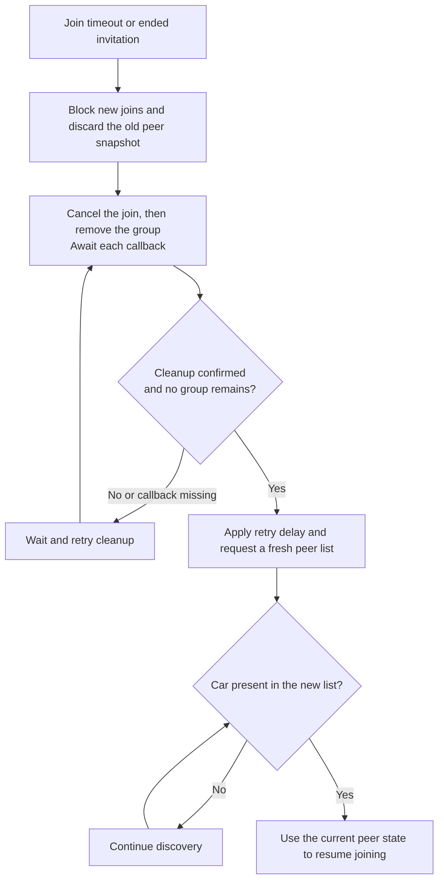

# Wireless CarLife and Android Auto in FT

Research date: 20 October 2026. Code baseline: upstream `5e308c6` (3.9.12).
The recovery changes described below are on `codex/wifi-direct-recovery`.

This document covers **WiFi + BL** mode. FT implements the phone side of
CarLife for the physical head unit. To show Android Auto, FT also acts as an
Android Auto head unit **inside the phone**. These are separate connections:
Android Auto cannot repair a failed CarLife Wi-Fi Direct connection.

## Connection sequence

This is the path implemented by FT, with group roles observed in the successful
RAV4 sessions below. CarLife bootstrap command names are FT's interpretation,
not quotations from an independently available wireless specification.

IP exchange is event driven: the car can request the IP before it is available;
FT sends it once both the request and the phone's address are present. The diagram
shows this dependency, rather than requiring a fixed order for every Bluetooth
notification. It does not depict the lower-level WPS or DHCP packet sequence.

The TCP listener defaults in [Prefs.kt](../app/src/main/java/app/ft/core/Prefs.kt)
and the channel handling in
[CarLifeLink.kt](../app/src/main/java/app/ft/carlife/CarLifeLink.kt) define the
CarLife transport. Discovery is sent to UDP `7999`, with an additional hello to
the group owner on UDP `8999`; see
[CarBeacon.kt](../app/src/main/java/app/ft/carlife/CarBeacon.kt).
Changing a Wi-Fi channel or the phone's local IP between sessions is compatible
with this design; the Bluetooth bootstrap communicates the current IP.

FT implements two directions for connecting this phone's Android Auto to its
local head unit in
[AaHeadUnitService.kt](../app/src/main/java/app/ft/aa/AaHeadUnitService.kt):

| TCP connection direction | Default destination | Setting | Meaning |
| --- | --- | --- | --- |
| FT → Android Auto | `127.0.0.1:5277` | `aaSelfPort` | FT dials Android Auto's head unit server |
| Android Auto → FT | `127.0.0.1:5288` | `aaPort` | FT listens for a projection connection |

Google's
[DHU documentation](https://developer.android.com/training/cars/testing/dhu#connect-using-adb-tunneling)
describes the phone's head unit server and its default TCP port `5277`.
[CarLifeService.kt](../app/src/main/java/app/ft/carlife/CarLifeService.kt) also
asks Android Auto to connect to FT at `127.0.0.1` and `aaPort` using a broadcast
to Android Auto's `WirelessStartupReceiver`. This is an implementation detail of
FT, not a guaranteed public Android Auto API. The log from 13 October includes
`head unit waiting for Android Auto on tcp:5288` and
`asked Android Auto to project onto FT at 127.0.0.1:5288`; the latter reports that
FT sent the request, not that Android Auto accepted it. The supplied logs contain
no `5278` entry.

These are different endpoints, not competing values for the same port. FT can
start both its listener and its outgoing dial loop; it does not require both TCP
paths to connect. Neither local port is a destination on the car. Android Auto's
server must be running for the first path to work; its absence cannot explain an
earlier failure to form a Wi-Fi Direct group. Connecting Android Auto from a
separate phone to FT's listener is outside this diagram.

## Bluetooth bootstrap: observed FT implementation

The following interpretations come from
[CarWirelessSetup.kt](../app/src/main/java/app/ft/carlife/CarWirelessSetup.kt).
`HU` means head unit; `MD` means mobile device, here FT on the phone.

| Direction | Message ID | FT interpretation and observed fields |
| --- | --- | --- |
| FT → HU | `0x00100001` | `MD_WIRELESS_INFO_REQUEST`, empty body |
| HU → FT | `0x00108002` | `HU_WIRELESS_INFO`; field 1 logged as `type`, field 2 as `band` |
| FT → HU | `0x00100004` | `MD_TARGET_INFO_REQUEST`, empty body |
| HU → FT | `0x00108005` | `HU_TARGET_INFO`; name in field 1, information in field 2, network in field 4 |
| HU → FT | `0x00108006` | `HU_IP_REQUEST` |
| FT → HU | `0x00100007` | `MD_WIFI_IP`; phone IP string in field 1 |
| HU → FT | `0x00108009` | `HU_STATUS`; field 1 logged as status |

In the failed attempts, `0x00108002` carried `08 03 10 01`, decoded as `type=3`,
`band=1`. No independent public definition of these enum values was found.
Do not equate them with “the GO is ready” or a particular frequency band.
FT currently treats a repeated notification with `type` in `2..4` as a cue to
call `carReady()`; this is implementation behavior, not proof that a group exists.
Repeated notifications also do not establish that an undocumented ACK is missing.

Baidu's [OEM integration portal](https://online.carlife.baidu.com/carlife/caroem/start)
provides an application process for integration materials. A complete current
public specification for these wireless bootstrap messages was not found.
The [archived Apollo DuerOS copy](https://github.com/fgrcwp/apollo-DuerOS) also
describes wireless code as unavailable publicly; it is historical context, not
a current normative specification.

## Reading Android's Wi-Fi Direct status

- `connect()` success means Android accepted the request. Wait for connection
  information reporting a formed group before treating it as connected.
- `ERROR` (`0`) is a general internal error. It does not identify an incorrect
  password, user rejection, overheating or a particular radio fault.
- `INVITED` is a pending-invitation state. It does not identify the initiator or
  prove that a confirmation dialog was displayed on the head unit.
- WPS capability flags describe supported methods, not whether a PBC window is
  currently open. FT uses PBC by default, a configured PIN selects keypad mode,
  and `groupOwnerIntent=0` expresses a preference for the phone to be the client.
- `enablePersistentMode(false)` controls saving the group configuration; it is
  not a guarantee that Android will avoid every previously saved group.

These API semantics are documented in
[WifiP2pManager](https://developer.android.com/reference/android/net/wifi/p2p/WifiP2pManager),
[WifiP2pDevice](https://developer.android.com/reference/android/net/wifi/p2p/WifiP2pDevice)
and [WifiP2pConfig.Builder](https://developer.android.com/reference/android/net/wifi/p2p/WifiP2pConfig.Builder#enablePersistentMode(boolean)).

The current
[AOSP service implementation](https://android.googlesource.com/platform/packages/modules/Wifi/+/refs/heads/main/service/java/com/android/server/wifi/p2p/WifiP2pServiceImpl.java)
adds useful context: the outgoing `CONNECT` path sets the peer to `INVITED`;
`isConfigInvalid()` rejects a target absent from `mPeers`; and
`reinvokePersistentGroup()` can look for an existing group before fresh
provision discovery. Its comments also warn that a GO does not always advertise
itself as one. This makes missing-peer retries a plausible explanation for the
immediate errors, and leaves stale persistent-group state as a hypothesis.
It does **not** establish that OPPO's closed firmware follows this exact revision.

## RAV4 case: what the supplied logs establish

The tested combination was a Chinese-market 2025 Toyota RAV4 with a `G6SA-23MM`
head unit, CarLife build `Platform_DesaySVCarLife_b2269f1_240201_R`, and an OPPO
`PHY110` phone on Android 16 / ColorOS `PHY110_16.0.10.500(CN01)`.
Timestamps below are copied from the supplied FT log, without timezone conversion.
Raw diagnostic archives and device addresses are not included in this document.

| Date and time | Evidence | Interpretation |
| --- | --- | --- |
| 18 Oct, 13:27:46.276 → 13:27:53.698 | Join request → formed group, `5745 MHz` | Successful formation in about 7.4 seconds |
| 18 Oct, 14:20:00.955 → 14:20:09.006 | Join request → formed group, `5745 MHz` | Successful formation in about 8.1 seconds |
| 18 Oct, 14:20:46.135 → 14:20:49.424 | Join request → formed group, `5785 MHz` | Successful formation in about 3.3 seconds |
| 20 Oct, 14:51:04.524 → 14:51:34.870 | Peer found, request accepted, `INVITED`, full 30-second timeout | No formed group was reported before FT timed out |
| 20 Oct, 14:51:36.196 onward | Car absent from new peer list, followed by cached-target retries | Old recovery code kept retrying a device no longer reported nearby |
| 20 Oct, 14:54:46.178 → 14:55:46.286 | Second attempt, full 60-second timeout | Increasing the wait did not establish a group |

All three successful sessions reported the car as group owner at
`192.168.49.1` and the phone as client on `p2p0`. The peer name
`Android_2e61` appeared in successful and failed attempts. There is no evidence
that a changed name caused this failure. The two successful frequencies also
show that a different channel between sessions is not inherently a fault.

There were 17 immediate `ERROR 0` results during the failed retry sequence around
14:51–14:56. The initial attempts really waited 30 and 60 seconds; a status
change after roughly one second did not terminate those two attempts early.
The car showed no confirmation prompt according to the driver. `INVITED` does
not contradict that report.

The supplied `logcat` covers a later period, not the original 14:51–14:56
attempts. It cannot establish the framework/supplicant reason for the first
failure. No public Toyota/Desay documentation or confirmed firmware issue was
found for this exact head unit/build, and no official known issue was found for
this exact ColorOS build. A firmware defect, stale persistent group, negotiation,
WPS or IP setup problem remains possible. These logs do not distinguish them.

## Recovery and diagnostics in this branch

The recovery in [CarFinder.kt](../app/src/main/java/app/ft/carlife/CarFinder.kt)
stops using the pre-timeout peer as a fallback. A timed-out join follows this
sequence before another join is allowed:

Each cleanup callback has a bounded wait. After an uncertain result, including
`BUSY`, `ERROR` or a missing action callback, recovery queries the actual group
and network state. It resumes only if no group exists, the P2P network reports
`IDLE`, `DISCONNECTED` or `FAILED`, and no P2P interface is up. A missing network
response or an active network keeps recovery blocked. When both cleanup actions
succeed, the group query must still confirm that no group remains. Generic
`ERROR` from cancellation allows group removal to be attempted, because Android
can return it when there is no pending join. An error callback alone is never
treated as successful removal. Immediate `connect()` rejection uses
the retry delay and fresh-peer requirement without removing an unrelated group.
Recovery and pending callbacks are invalidated when FT stops or its channel is
replaced. Repeated Bluetooth notifications cannot bypass cleanup.

The 23 October logs from 3.9.14-custom show why the actual-state check is needed:
Bluetooth bootstrap succeeds, but a P2P invitation times out after the selected
60 seconds. Cancellation succeeds, removal returns `BUSY`, and subsequent
cancellations keep returning `BUSY` without any group query. The old recovery
therefore never reaches another join. Version 3.9.15-custom removes this recovery
deadlock; the initial group-formation timeout still needs a vehicle test with
the head unit started before FT.

On Android 15/API 35 and newer,
[P2pDiagnostics.kt](../app/src/main/java/app/ft/carlife/P2pDiagnostics.kt) registers
the public `WifiP2pListener` for group creation, user rejection, creation failure
and removal. The Android
[framework source](https://android.googlesource.com/platform/packages/modules/Wifi/+/refs/heads/main/framework/java/android/net/wifi/p2p/WifiP2pManager.java)
defines the failure reasons separately from `ActionListener` error codes:
`0` cancelled, `1` timeout, `2` user rejection, `3` provision discovery failure,
`4` group removal and `5` invitation failure. Logs retain both the numeric value
and description with the current FT attempt context. These are system-wide
events; temporal proximity alone does not prove the event belongs to FT.
If listener registration is unavailable, normal connection handling continues.
Older Android versions retain the broadcast and watchdog diagnostics.

The additional logs record discovery state, request acceptance, peer state,
group role/frequency and cleanup outcome. They never print a WPS PIN or stringify
`WifiP2pGroup`, whose representation can contain a passphrase. Existing diagnostic
reports can still contain identifying device/network information and should be
reviewed before publication.

## Next vehicle test

1. Use **WiFi + BL** and preserve the diagnostic archive from the first failed
   attempt, before changing settings or restarting either device.
2. Check for `join attempt=… accepted`, `Android P2P event: …`, a timeout snapshot,
   cleanup results and the fresh peer list. A missing optional system event
   is not proof that its underlying operation never happened.
3. If the car disappears, FT should keep searching without a chain of stale-peer
   `connect()` calls. If cleanup is unconfirmed, FT should wait rather than overlap
   another join with teardown.
4. A `joined group` entry followed by CarLife TCP/handshake messages establishes
   progress past this fault. Only then diagnose the local Android Auto server and
   projection. Repeat at least one disconnect/reconnect cycle.

The changes address retry correctness and improve evidence collection. They have
not yet been tested in this vehicle and do not establish a fix for the first
group-formation timeout.

## Lock and unlock interruptions, 24 October

The 3.9.15-custom vehicle logs show six closures of the local Android Auto
developer-server connection on TCP 5277 while wireless CarLife continues sending
frames to the head unit. USB-state broadcasts with `connected=false` and
`configured=false` occur near these closures; the `unlocked` flag changes with
the phone lock state. FT's USB-state receiver only logs these broadcasts. It
does not close the Android Auto connection. This correlation does not establish
which Android Auto or system component closes the local socket.

No Android Auto `BYEBYE`, video-stop message or lost video surface precedes the
observed socket failures. The supplied FT logs do not include Android Auto's
internal reason for closing its endpoint.

Version 3.9.16-custom wakes the reconnect worker immediately after a real session
closure. Failed connection attempts use delays of 250, 500, 1000 and then
3000 milliseconds. Session ownership remains reserved until media cleanup
finishes; stale callbacks, pending dials and workers from an earlier service run
cannot replace or clear a newer session. Closing a session also discards its
codec configuration, and an old decoder output cannot publish a late frame size.
Disconnect diagnostics include the session ID, transport, exception, duration,
screen/keyguard state and USB flags. These changes improve recovery; they do not
prevent the peer from closing the socket.

For the vehicle test, repeat three to five lock/unlock cycles with the map and
audio active. Note the time of any pause and export FT diagnostics immediately
afterwards. If interruptions continue, also capture an Android system bug report
on the phone using **Developer options > Take bug report**, then share the report
from its completion notification. This requires no USB connection. The official
[Android bug-report instructions](https://developer.android.com/studio/debug/bug-report)
describe the capture process and the system logs included in the report.
